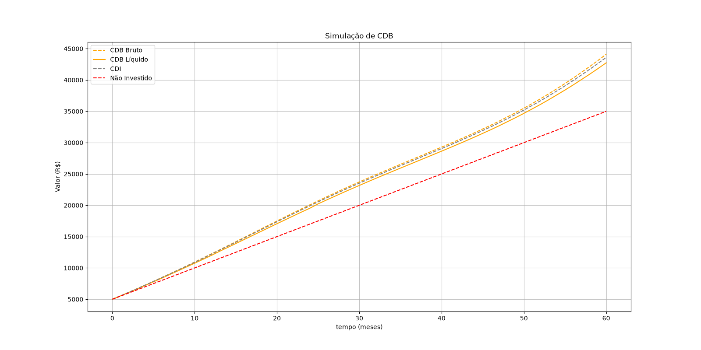

# Simulador de Investimentos atrelados ao CDI


Simulador de investimentos (CDB, LCI, LCA) atrelados ao CDI, com cálculo de IR regressivo e comparação de rendimento, projeto de estudo em Python, numpy e matplotlib.

## 📊 Exemplo de simulação

Simulação de um CDB (105% do CDI) com capital inicial de R$ 5.000, aportes mensais de R$ 500 e CDI de 12% a.a. ao longo de 5 anos, utilizando CDI variável modelado por uma função senoide escada:



📓 Veja a análise completa, com todos os cenários comparados, em [`notebooks/analises.ipynb`](notebooks/analises.ipynb).

## 📌 Descrição
Este projeto tem como objetivo praticar lógica de programação em Python, modularização de código, visualização de dados com matplotlib e manipulação da biblioteca numpy, utilizando como contexto uma simulação de investimentos atrelados ao CDI.

OBS: O foco do projeto é educacional, não sendo uma ferramenta de previsão ou recomendação de investimentos financeiros.

## 🚀 Funcionalidades
- Cálculo do montante bruto e líquido de LCI, LCA e CDB, pós-fixados (% do CDI) ou prefixados (taxa travada)
- Comparação com o CDI
- Simulação do valor não investido (dinheiro parado)
- Modelagem de cenários de mercado (alta ou baixa) com uma taxa de CDI variável no tempo, para comparar como pós-fixado e prefixado se comportam sob incerteza
- Dois modelos de taxa variável: senoide (oscilação suave) e escada com `floor` (patamares e degraus, como nas decisões do COPOM)
- Geração de gráfico temporal comparando as opções


## 📁 Estrutura do Projeto
```bash
simulador-cdi/
│
│── main.py
│── README.md
│── requirements.txt
│── LICENSE
│── .gitattributes
│── .gitignore
│
│── assets/
│   └── exemplo_simulacao.png
│
│── docs/
│   ├── conceitos.md
│   └── conceitos.pdf
│
│── src/
│   ├── calcular.py
│   ├── graficos.py
│   └── modelagem.py
│
└── notebooks/
    └── analises.ipynb
```

## 🚀 Como Executar

1. Instale as dependências:

```bash
pip install -r requirements.txt
```

2. Execute o simulador:

```bash
python main.py
```

## 📜 Referencias

Os detalhes matemáticos de cada cálculo (conversão de taxa, IR regressivo, montante com aportes, modelagem da taxa variável com senoide e escada), e também devidas referencias, estão documentados em [`docs/conceitos.pdf`](docs/conceitos.pdf).